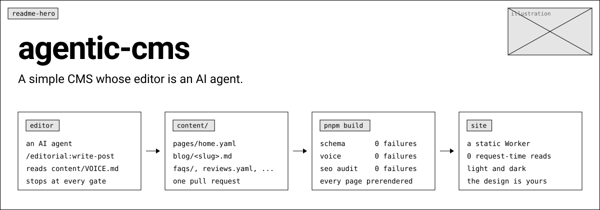
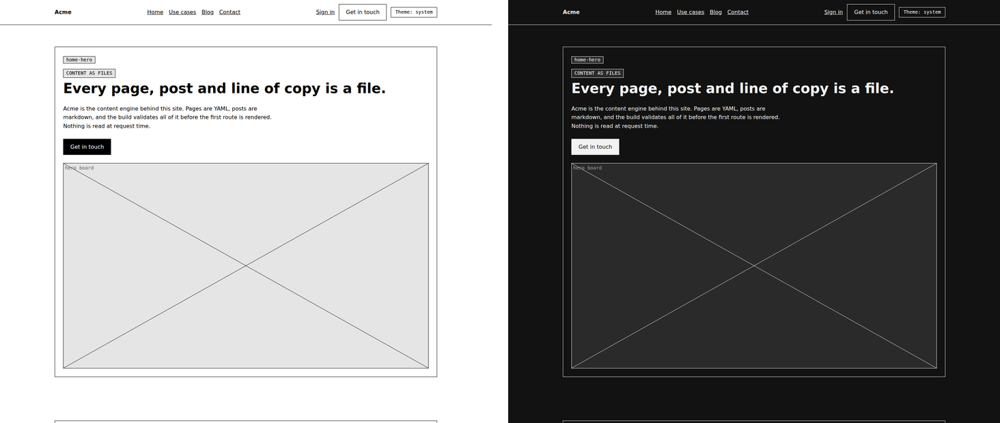
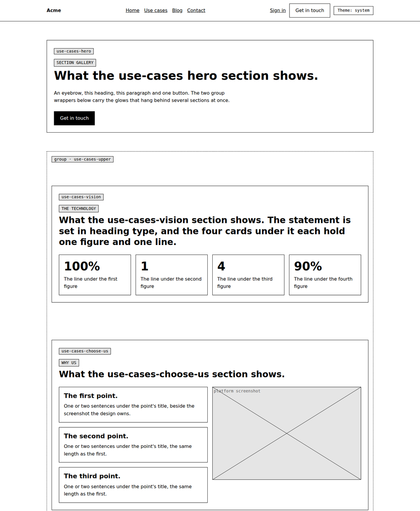
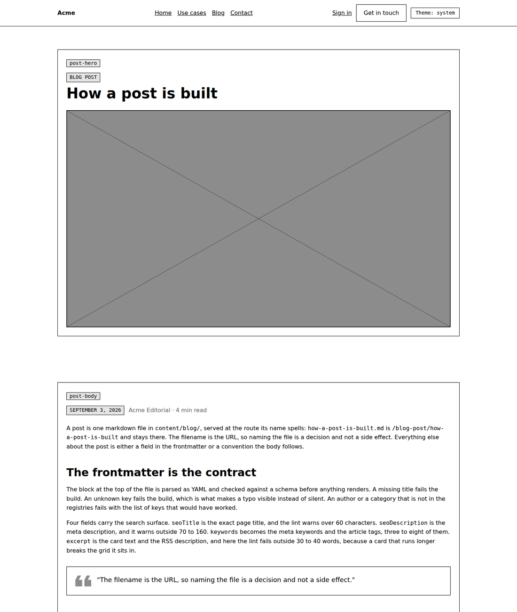
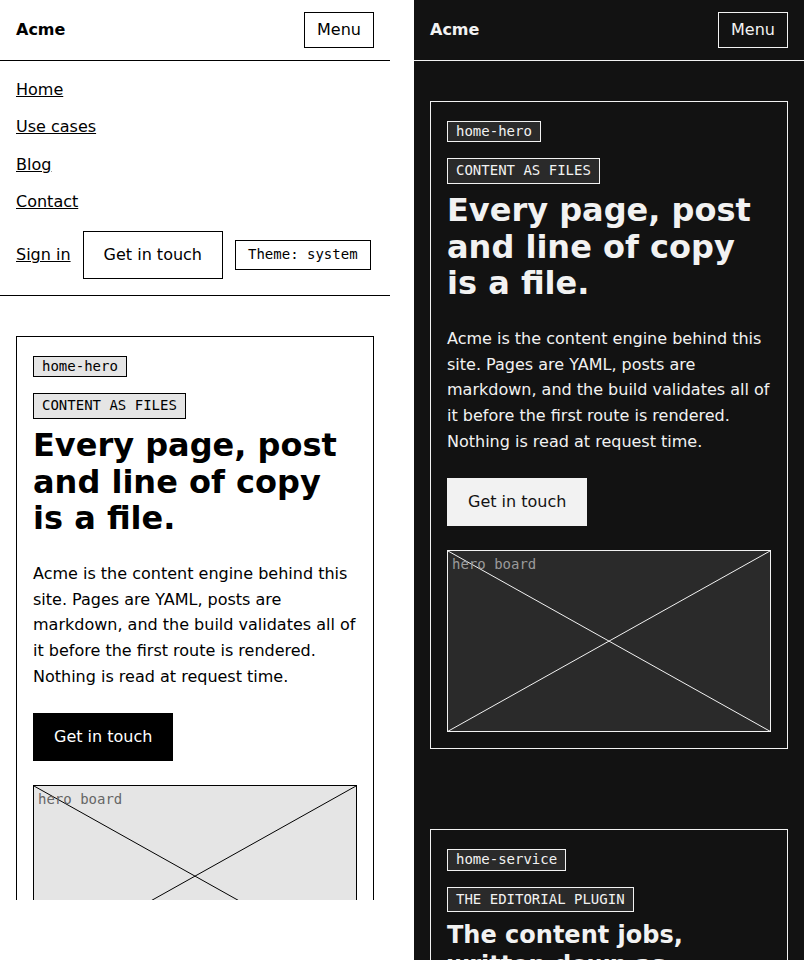

<div align="center">

<picture>
  <source media="(prefers-color-scheme: dark)" srcset="docs/readme/banner-dark.svg">
  
</picture>

**Pages, posts and every line of copy are files in a Next.js repo.**<br>
**An agent edits them. The build says no. What ships is static.**

      

[The loop](#the-loop) · [The parts](#the-parts) · [Files, not a database](#files-not-a-database) · [Next to Payload](#next-to-payload) · [A page is a file](#a-page-is-a-file) · [A post is a file](#a-post-is-a-file) · [The voice is a lint](#the-voice-is-a-lint) · [The editor is an agent](#the-editor-is-an-agent) · [So is the designer](#so-is-the-designer) · [The proof is a diff](#the-proof-is-a-diff) · [Built on it](#built-on-agentic-cms) · [Start your own site](#start-your-own-site)

</div>

agentic-cms is a CMS whose editor is an AI agent: content as files in a
Next.js repo, validated at build time; the content, blog, SEO and form
engines, the motion library, and the command line that lints, audits and
screenshots a site built on them.

## The loop

**1. The agent edits a file.** The landing page is `content/pages/home.yaml`:
its SEO block, its structured data, its sections in order with all their
copy. A post is `content/blog/<slug>.md`. The `editorial` plugin gives Claude
Code and Codex the skills that write, add, update, review, retire and report
on that content, reading the site's own rules from the repo and stopping at
every gate for a person.

**2. The build says no.** The lint runs first: a word of copy written in
code, a head tag written by hand, a form or a tag outside its engine fails
it, naming the part to use. Then every file is parsed against its schema,
every string is read against the site's voice rules, and every prerendered
page is audited for its title, description, canonical, Open Graph,
headings, image attributes, structured data and sitemap entry. Break a few
things and build; past the lint, these are the lines it stops on, verbatim:

```
$ pnpm build
…
FAIL content/blog/pages-are-files.md em-dash: title contains an em dash; use a period, a comma, or restructure the sentence
FAIL content/blog/pages-are-files.md voice-banned: excerpt "seamless" is banned (hype); write "say what the reader does not have to do"
WARN content/blog/pages-are-files.md seo-title: seoTitle is 66 characters; Google shows about 60
FAIL content/pages/home.yaml schema: sections[0].eyebrow is required
FAIL content/pages/home.yaml schema: sections[0] unknown key(s) eyebrows
FAIL content/pages/home.yaml schema: sections[2].cards must have exactly 5 cards
content-lint: 8 collections, 12 entries, 5 failures, 1 warning
```

`pnpm content:lint` gives the same answer in about a second, without the build.

**3. What ships is static.** Every page is prerendered and served as a file:
from a Cloudflare Worker's asset cache, as the example is, or from a Node
server's standalone package, which `agentic-cms assemble` completes and
checks. There is no database, no admin screen and no request-time read; a
copy change is a diff, a review and a deploy.

```bash
git clone git@github.com:HKamkar/agentic-cms.git && cd agentic-cms
pnpm install
pnpm dev          # http://localhost:8000, then change a line in content/pages/home.yaml
```

<div align="center">

</div>

## The parts

Every part of the kit is on one map, [docs/parts.md](docs/parts.md): the
need it meets, how to use it, its tier and the check that holds it, in
four layers.

| Layer | Ships | Parts |
|---|---|---|
| The content engine | the pages | the collections (`agentic-cms/content`), composed once with `createKit()`, a JSON Schema for each (`agentic-cms schema`), the redirects among them; on it pages (`content/pages/`, the section registry), the post pipeline (`agentic-cms/blog`), SEO (`agentic-cms/seo`) and a site's other languages (`agentic-cms/locales`, experimental); beside it forms (`agentic-cms/forms`) |
| Browser libraries | to the reader | motion (`agentic-cms/ix`), the components (`agentic-cms/components`), consent (`agentic-cms/consent`), e-mail (`agentic-cms/email`), `agentic-cms/cx` |
| Design tools | never | the lab, design rounds (`demo`), the screenshot harness (`visual-parity`, `parity`, `shot`, `probe`, `sheet`), icons, images, the design skills |
| The site's commands | the build and the setup | `init`, `upgrade`, `setup`, `urls`, `serve`; the gates every change passes (`pnpm lint` with `check-site`, `pnpm build` with `seo` and `guard-email`) and the steps a site adds (`critical-css`, `assemble`, `pr-preview`); `agentic-cms/eslint`, `agentic-cms/loader` |

Two tiers:

- **The engines are required.** Every word a reader sees comes from
  `content/` or the chrome in `src/config/site.ts`; the head and the
  structured data come through `kit.seo`; a form through the form engine;
  a tag that needs consent through `agentic-cms/consent`; an address on a
  page through `EmailLink` and the guard. Code that goes around one fails
  `pnpm lint`, so `pnpm build` and CI too, and the message names the part
  to use. A real need is a named exception with its reason.
- **The rest is preferred.** A site may bring its own motion library, a
  canvas, `next/image` or a script of its own: the lint warns, names the
  kit's part and passes, and one line of reason keeps the choice (an
  `allow` entry in `src/config/components.json`, or an inline disable with
  its description).

## Files, not a database

| | agentic-cms | A CMS with a database |
|---|---|---|
| Where the copy lives | `content/`: eight collections, one folder, one pull request per change | rows behind an admin screen |
| Who edits it | an AI agent, with a person approving each gate; or anyone with an editor | people in the admin screen |
| What stops a mistake | the build, with a line that names the file, the field and the problem | a preview, if someone looks |
| What runs at request time | nothing: prerendered, static, cached at the edge | a query per page |
| The design | yours: what ships is a wireframe a fork replaces, with the machinery kept | the theme's |
| When it is the wrong tool | copy that must change without a deploy, a search over thousands of entries, or authors who will never open a pull request | — |

## Next to Payload

Payload's homepage headline reads
["The Agentic Content Framework"](https://payloadcms.com/), and the two are
different tools.
[Payload](https://payloadcms.com/docs/getting-started/what-is-payload) is a
Next.js full-stack framework: from a TypeScript config it gives an admin
panel, a database with migrations, REST and GraphQL APIs, authentication
and access control. An agent reaches its content through the official
[MCP plugin](https://payloadcms.com/docs/plugins/mcp), which finds,
creates, updates and deletes documents behind an API key and the
collections' access control. agentic-cms has none of those. Its content is
files in git, its editor is an agent working in pull requests, and its
build refuses what breaks the site's rules: the schema, the voice and the
claims, the SEO, the engines in code. A pixel proof shows what a change
moved before it merges, and what ships is static.

| | Payload | agentic-cms |
|---|---|---|
| Content lives in | a [database](https://payloadcms.com/docs/database/overview): MongoDB, Postgres or SQLite | files under `content/`, in git |
| Who edits | people in the [admin panel](https://payloadcms.com/docs/admin/overview), with [drafts](https://payloadcms.com/docs/versions/drafts), [versions](https://payloadcms.com/docs/versions/overview), [live preview](https://payloadcms.com/docs/live-preview/overview) and [localization](https://payloadcms.com/docs/configuration/localization); an agent through the MCP plugin | an agent, in a pull request a person merges |
| An agent's mistake meets | [field validation](https://payloadcms.com/docs/fields/overview) and [access control](https://payloadcms.com/docs/access-control/overview) on the write, then the database | the build (schema, voice, SEO, engines), then the review |
| Design | the site's own code | the component library's rules, and a pixel proof before a merge |
| At request time | the admin, the APIs and the database, as a server; the site's own pages may be [prerendered at build time](https://payloadcms.com/docs/production/building-without-a-db-connection) | nothing: prerendered and static |
| Pick it when | editors don't use git, the site has logins, content changes without a deploy | an agent runs a marketing site or a blog, and its voice, SEO and design must hold |

Payload's side is as its own site and the docs of its current release,
3.x, read on 2026-10-29: each fact links the page it comes from.

## A page is a file

```yaml
# content/pages/home.yaml
seo:
  path: /
  title: "Acme: content as files, checked on every build"
  description: Acme is a CMS whose editor is an AI agent. Pages, posts and copy are files, validated at build time, prerendered, and served with no request-time reads.
  ogImage: /images/home-og.jpg
  updated: "2026-09-18"
  breadcrumb: Home
jsonld:
  type: WebPage
  application: { name: Acme, description: …, operatingSystem: Any (static site), offer: …, featureList: [ … ] }
sections:
  - type: home-hero
    eyebrow: Content as files
    heading: Every page, post and line of copy is a file.
    text: Acme is the CMS behind this site, and its editor is an AI agent. Pages are YAML, posts are markdown, and the build validates all of it before the first route is rendered.
    cta: Get in touch
  - type: home-service
    …
```

The `seo` block becomes the head, the canonical and the sitemap entry. The
`jsonld` block becomes the page's structured data (`WebPage`, `AboutPage`,
`ContactPage` or `Blog`, each with its own fields). Each `type` names one of
24 section components (a `group` nests them), and its copy schema says
exactly what the section takes; a card list has an exact length, so a fourth card is a design change
rather than a typo. Presentation stays in the component. There is no
`page.tsx` to write: one catch-all route renders every page file.

The four pages under `/sections/` are the example's catalogue: every
section type the landing page leaves out, rendered with copy that says what
each slot is for. A site laid out by `init` starts without them.



## A post is a file

```yaml
---
title: Pages are files
excerpt: >-
  A page on this CMS is one YAML file with three blocks. An SEO block, a
  structured-data block and a list of sections in order. Here is what each block
  holds and what the build does with it.
date: '2026-09-09'
category: guides
author: acme-editorial
image: /images/blog/pages-are-files/pages-are-files-hero.webp
imageAlt: A wide grey placeholder standing in for the hero illustration of this post
seoTitle: Pages are files | Acme
keywords: [page as a file, YAML, section types, structured data, SEO audit]
related: [how-a-post-is-built, the-voice-file-and-the-lint]
publishedAt: '2026-09-09T09:00:00.000Z'
---
```

The filename is the URL. The body is markdown with four conventions the
renderer keys off: headings start at `##`, a `> "quote"` becomes the
pull-quote card, an image alone in its paragraph becomes the figure block,
and a `## Frequently asked questions` heading with `###` questions becomes
the accordion and the `FAQPage` structured data. The lint checks the
frontmatter's SEO limits, the heading structure, the FAQ's shape, the alt
texts and that every image exists on disk and weighs under 250 KB.



## The voice is a lint

`content/VOICE.md` says how the site writes and what it never claims. Its
fenced block is machine-readable: banned words and patterns, the brand's
spelling and mark, the words that count as claims near a regulation, model
and cloud names, the SEO ranges. `agentic-cms lint` reads it on every
build. Exact rules fail; heuristics warn. What the lint cannot judge (rhythm,
an unsupported number, a misattributed date) is what the two review agents
are for.

## The editor is an agent

`plugin/` is one plugin for Claude Code and Codex. It reads everything it
needs from the repo it stands in and carries nothing of any brand.

| Skill | Does |
|---|---|
| `/editorial:write-post` | a post from a brief in four gated stages: outline, body, the two reviews in isolation, SEO fields |
| `/editorial:new-post` | a post from a draft file, with its images and frontmatter, as `draft: true` |
| `/editorial:update-post` | an edit to a post, the two dates and the URL intact |
| `/editorial:new-page` | a page from the template, made of existing section types |
| `/editorial:retire-content` | a post hidden (its URL kept), or a page or a post removed with its redirect, written into `content/redirects.yaml` |
| `/editorial:translate` | a page's, a post's or a collection's translation drafted beside its original, for a native speaker to check; a legal text translated, never rewritten |
| `/editorial:review-voice` | a file read against `VOICE.md` for what the lint cannot judge |
| `/editorial:critic` | a post read hard by an editor who did not watch it being written, every external claim checked against primary sources |
| `/editorial:content-status` | what is live, in draft, planned and recently changed, read-only |

The two review skills, `review-voice` and `critic` (the critic fact-checks
against primary sources), also run as Claude Code agents
`editorial:voice-reviewer` and `editorial:critic`, in isolation from the
conversation that wrote the draft. The same directory installs in Claude Code
and in Codex. The repo is its own marketplace for both, and so is the
installed package: `.claude/settings.json` turns the plugin on for Claude
Code in a checkout, and in a site laid out by `init`, which reads it from
the package at the version it pins. Elsewhere:

```bash
claude plugin marketplace add git@github.com:HKamkar/agentic-cms.git && claude plugin install editorial@agentic-cms --scope user
```

```bash
codex plugin marketplace add HKamkar/agentic-cms && codex plugin add editorial@agentic-cms
```

`plugin/README.md` is the contract: what a site offers the plugin, what the
skills write, and the optional workshop file for marketing that lives outside
the repo.

## So is the designer

A site's look is designed the same way its copy is edited: by an agent,
one element at a time, with the owner picking at every gate. The design
skills ship in the repo (`.claude/skills/`, `.agents/skills/`, found by
Claude Code and Codex with nothing installed) and in the package, as its
`design` plugin, and every one of them works
through the command line, so what a round leaves behind is files and a
proof, never a tool in the reader's browser.

| Skill | What it does, and the commands under it |
|---|---|
| `design` | a site from the wireframe to a look of its own: tokens first, then the chrome, then the sections |
| `design-options` | a design round: three to five ideas, the picked ones built as real components on a throwaway route in the section's own frame with the page's copy (`pnpm kit demo new`), the owner picks by letter; `demo clean` then removes everything the round created that the winner does not use, and says what it keeps and why |
| `design-graphics` | the site's own drawings as SVG in the lab (`pnpm kit lab`): scenes on the site's tokens in each of its schemes, at the sizes they ship and on a phone, a timeline to step through a loop, rendered to the file a page ships; a loop that should play when it is seen goes inline (`InlineAnimation`, `readInlineSvg`) |
| `design-icons` | icons as families: the inventory of every icon beside its copy (`icons audit`), Lucide and Simple Icons maps (`icons add`), marks from primitives (`icons family`), and a round for a set of the site's own (`icons round new / publish / retire`) |
| `design-measure` | a screenshot claim turned into numbers before an edit: an element's box, styles and stacking chain (`probe`), a crop (`shot`), candidates at their real size on their real grounds (`sheet`) |
| `design-proof` | the change proven on the pixels (below) |

[docs/design.md](docs/design.md) is the loop, [docs/lab.md](docs/lab.md)
the lab, [docs/icons.md](docs/icons.md) the icons,
[docs/shot-probe-sheet.md](docs/shot-probe-sheet.md) the one-shot commands.

## The proof is a diff

A refactor must not move a pixel, and a design change must move only the
pixels it meant to. `agentic-cms visual-parity` photographs every page of
the production build at the site's widths, in each of its colour schemes,
and diffs two captures pixel by pixel:

```bash
pnpm kit visual-parity capture before --ref develop   # the baseline: that commit built in a sibling worktree and captured
pnpm kit visual-parity capture after --build          # this tree, built and copied first, so it is free while the capture runs
pnpm kit visual-parity compare before after           # exit 1 on any difference, one line per file
pnpm kit visual-parity proof --states                 # or all of it in one: baseline, after, compare, per pass
```

The rendering is made deterministic before a shot is taken: reduced
motion, frozen transitions, every reveal at its end state, every image
loaded, every inline SVG animation held at its rest frame, other origins'
scripts and beacons (analytics, widgets) held back. `--motion` plays
the animations and photographs each scroll step mid-flight and settled,
with an inventory of every animation; `--states` photographs hover, focus,
checked and open. A compare line says what changed and where: `SIZE …
shift` when one section grew and pushed the page down, and a `cause:` line
naming the section and its height change, down to a fraction of a pixel.
What a site shows until a visitor's choice is stored — a consent banner
over the page — is closed by a seed in `src/config/harness.ts`, written
into every page's storage before its scripts run, on both sides of a
proof. The same file is the site's profile: the widths it is designed at,
the schemes it has and what a bare `proof` covers, which every capture
takes unless a flag says otherwise — so a site without dark mode is never
proved in one, and `init --light-only` lays out such a site
([docs/visual-parity.md](docs/visual-parity.md#the-sites-profile)).

A proof costs what the change touched. Every page-width whose build files
are the same bytes as when it was last photographed is copied from the
cache, so the after capture takes the changed pages alone and a baseline
taken again is seconds; several browsers work at once (`--jobs`), and a
site with many posts can photograph a few of each template (`--sample`).
On the example, the whole static set is 44 seconds from nothing on four
cores and one edited post is 18. `--fresh` retakes everything.
[docs/visual-parity.md](docs/visual-parity.md) is the contract.

## The wireframe you replace



Four colours, each a `light-dark()` pair (`paper`, `ink`, `fill`, `muted`);
a system font stack; no radius, shadow or motion; a theme switch that follows
the system until a reader picks. Every section renders in a box that prints
its own YAML type, so the page and the page file read side by side.
Illustrations are crossed placeholder boxes; content images come from
`pnpm kit placeholder <out> <width> <height>` until real ones exist.
`STANDARD.md` is the design system; `src/components/README.md` the catalogue,
and the only place UI is made: `pnpm lint` runs the component rules
(`agentic-cms/eslint`), which fail a section that writes a raw element or
draws a box of its own, or an import that goes the wrong way between the
layers, then the site check (`agentic-cms check-site`): its first pass,
the placement guard, fails a component outside the library, an export the
catalogue does not name, or a section file the registry does not render,
and its own fail a design round made by hand and a `lint` or `build` that
dropped a gate, and list every exception added since the merge base. The rest it guides
and never blocks: another animation library, a canvas, `next/image`, an
`<svg>` outside `Icon` or a value outside the tokens warns, naming the
kit's part, and a site keeps its own choice with one line of reason
(`allow` in `src/config/components.json`). The `agentic-cms/ix` library stays in the package for a fork that wants
motion: a play-once layer (`Reveal`, `RevealGroup`, `Sequence`, `part()`)
whose roots play the first time they are seen and never again, the
scroll-into-view reveals and sequences that replay on each entry, and
`InlineAnimation`, a site's own SVG loop that plays in view and rests for a
reader who prefers reduced motion.

## Built on agentic-cms


[deeplit®](https://deeplit.ai), private AI infrastructure from Delft, is
the first site on the package. Its design — the sections, the chrome, the
CSS modules, the images, the reveals and sequences on `agentic-cms/ix`, the
icons drawn in design rounds, the loop on its Platform page — its content
and its config live in its own repo; the engines, the libraries and the
command line come from here by tag (`github:HKamkar/agentic-cms#v0.9.0-rc.0`),
composed once in its `src/kit.ts`, and it runs as a Node server from the
standalone package `agentic-cms assemble` completes. Same page files, same
post pipeline, same lint and audit as the wireframe above; the design is the
part a site brings.

## Start your own site

Two ways. **Fork** this repo when you want the example around
you — the wireframe, the section galleries, the posts that describe it —
and replace it piece by piece. **Install** the package when your site is its
own repo, as deeplit's above is, and let it lay the site out:

```bash
pnpm dlx --allow-build=agentic-cms@git+https://github.com/HKamkar/agentic-cms.git agentic-cms@github:HKamkar/agentic-cms#v0.9.0-rc.0 init my-site --name "My Site"
cd my-site && bash scripts/setup.sh && pnpm kit serve
```

The kit is a git dependency that builds its `dist/` as it installs, which
pnpm runs only when allowed by that exact key; `init` writes it into the
site's `pnpm-workspace.yaml` with the others the site's install needs, and
the site's CI workflow with it.

`init` lays out the example's code with a starter in place of its content,
under the name `--name` gives, as it is spelled (a new site needs it:
without it `init` writes nothing; `--url` and `--email` give the site's
address): one home page and the blog index
whose copy is marked `(placeholder)`, the collections empty, the wireframe's
neutral pictures and a logo placeholder with the site's name. Nothing of the
example's brand, posts, reviews, use cases, FAQs, author or catalogue pages
comes along, so a design starts from the site, never from the example.
`pnpm content:lint` names each placeholder by file and field; a production
build fails while one remains (the site's own CI, which deploys nothing,
keeps them warnings), and the example's brand fails the lint in a site at
any time.

`init` writes the gates as well. `pnpm lint` is ESLint with the kit's
preset, then `agentic-cms check-site`; `pnpm build` runs `pnpm lint`
first, then the content lint for production, the field tables' check,
`next build`, the SEO audit and, last, `agentic-cms guard-email`, because
the starter's `src/config/site.ts` sets `guardEmail: true`. With it, the
address reaches a reader only as the token `EmailLink` decodes, never as
text in a page, a payload or a bundle ([docs/email.md](docs/email.md)); a
site whose address is public on purpose says so with
`guardEmail: { off: "<why>" }`. Into a `package.json` that is there,
`init` merges the gates into the site's own `lint` and `build`, or refuses
and names what to add. The CI workflow, `.github/workflows/verify.yml`,
runs the lint, the tests, the build and the agent-file check on every pull
request, and, opted in on Cloudflare Workers, a preview of each at a link
of its own, never indexed ([docs/preview.md](docs/preview.md));
`.github/dependabot.yml` keeps its actions current: GitHub Actions alone,
monthly, in one grouped pull request.

Either way the site carries, from its first session, what an agent needs
to design it: the rules (`AGENTS.md`, and `.claude/rules/`, which Claude
Code loads by path and Codex finds through `AGENTS.md`'s scoped-rules
table), the design skills (`design`, `design-options`, `design-measure`,
`design-icons`, `design-graphics`, `design-proof`) and the commands they
call. A fork has the skills in `.claude/skills/` and `.agents/skills/`. A
site laid out by `init` reads them from the installed package, at its pin:
the `design` plugin, which `.claude/settings.json` names, and a stub per
skill in `.agents/skills/` for Codex; each rule there is thin, pointing at
the kit's whole rule. [docs/init.md](docs/init.md) is what `init` writes
and what comes next; [docs/design.md](docs/design.md) is the loop.

<details>
<summary><b>Then: the six steps</b></summary>

1. Forking: rename the package and the plugin marketplace to your own name,
   and drop the Cloudflare files if you host elsewhere. Renamed, the fork
   is a site: the example's brand fails the content lint and `check-site`
   lists the rest of the example, so take them into a baseline first
   (`pnpm kit check-site --baseline`) and replace them a pull request at a
   time ([docs/migrating-to-0.8.2.md § 3](docs/migrating-to-0.8.2.md#3-the-examples-leftovers)).
   Installing: `init`
   wrote `src/kit.ts`, where your site composes the engine — the one file
   the app and the command line read (server code only):

   ```ts
   import { createKit } from "agentic-cms";
   import { sectionSchema } from "@/components/sections/schemas";
   import { site } from "@/config/site";
   export const kit = createKit({ site, sections: sectionSchema });
   // kit.collections · kit.content (getPages, getPage, getFaq, …) · kit.blog (getAllPosts, getRelatedPosts, …)
   // kit.seo (pageMetadata, pageJsonLd, postMetadata, sitemap, feed, robots, …) · kit.urls (postUrl, absoluteUrl) · kit.site
   ```

   and `package.json` names the commands: the gates, `"lint": "eslint;
   s=$?; agentic-cms check-site || s=1; exit $s"` and `"build": "pnpm lint
   && agentic-cms lint --production && agentic-cms docs --check && next
   build && agentic-cms seo && agentic-cms guard-email"`; `"content:lint":
   "agentic-cms lint"`, `"content:check"`, `"content:status"`,
   `"content:docs"`, `"urls"`, `"kit": "agentic-cms"`; and for the site's
   own tests `"test": "node --import agentic-cms/loader --test
   \"src/**/*.test.ts\""`.
2. `content/VOICE.md`, your voice and claim rules; the prose and the fenced
   block say the same thing. Installing: `init` wrote it from
   `content/_templates/VOICE.md` with your site's name and the generic
   rules, so write its sections. Forking: copy the blank and write it.
3. The copy, before any design: installing, the starter's placeholders —
   the home page, the blog index, the tagline and the address in
   `src/config/site.ts` — from you or `/editorial:new-page`; forking, the
   example's registries, reviews, FAQ sets, use cases, page files and
   posts, and keep or delete the `/sections/*` demo pages.
   `content/README.md` is the door; `content/_templates/` has an annotated
   template per collection.
4. `src/config/site.ts`: the brand, the URL, the e-mail and address, the nav,
   the footer, the calls to action (data only, `satisfies SiteConfig`).
5. `src/app/globals.css`: the tokens — or start the `design` skill, which
   begins there and designs around your real copy. Each colour is a
   `light-dark()` pair, so both themes follow; a site without dark mode
   starts from `init --light-only`.
6. `pnpm content:lint` until clean, no placeholder left, `pnpm build`, then
   the host of your choice: the example's Cloudflare Worker, or a Node server
   ([docs/deploy.md](docs/deploy.md): `output: "standalone"` and
   `agentic-cms assemble` as the build's last step).

</details>

A new kind of section is a copy schema, a component and a registry entry
(`src/components/sections/`). A collection of your own is a schema and a
definition returned from `createKit`'s `collections` option
(`src/lib/content/README.md`). A new form is an entry in `src/config/forms.ts`
(every ordinary field type, notes and groups, a prefill from the URL); it
delivers by `mailto`, or through the site's one dynamic route to a
webhook or a provider of the site's choosing ([docs/forms.md](docs/forms.md)).
Analytics waits for the visitor's consent: `agentic-cms/consent` keeps the
choice in their browser and `agentic-cms/consent/google` loads the Google
tag only once they allow it, with consent mode v2 denying everything until
then; the banner is the site's own design, and the example's is off until
`GOOGLE_TAG_ID` is set ([docs/consent.md](docs/consent.md)).

## Upgrading

A site pins the package by tag, and moves to a release with that
release's own code: `pnpm dlx agentic-cms@<version> upgrade` (`--dry-run`
first) moves the pin, runs each migration in between, rewrites the kit's
lines of the agent files and keeps the site's own, prints each step left
by hand with its section of [docs/upgrading.md](docs/upgrading.md), then
runs the lint and the tests ([docs/upgrade.md](docs/upgrade.md)). Nothing
of the kit's is merged by hand: the skills and the guides are read from
the package, and `--agent-files --check`, in the site's CI, fails a rule
that dropped a line the kit marks required. What a site can rely on
between versions is [docs/stability.md](docs/stability.md);
`CHANGELOG.md` says what changed and marks every change to what a capture
writes.

From 0.8.x, [docs/migrating-to-0.9.0.md](docs/migrating-to-0.9.0.md) is
the guide: the upgrade, the site's `AGENTS.md`, the host's redirects into
`content/redirects.yaml`, and what a site may adopt. A site on 0.8.1
takes [docs/migrating-to-0.8.2.md](docs/migrating-to-0.8.2.md) first:
the upgrade in one pull request, with a baseline
(`check-site --baseline`) that holds what the site has now, so CI stays
green and nothing a reader sees changes, its engine bypasses, its
sections' composition findings and the example's leftovers held while new
code meets the full rules; then, a pull request at a time, the copy
written in code moved into content files, the sections rebuilt from the
library, the example's leftovers replaced, a reason for each
preferred-tier warning, and the e-mail key. The baseline only shrinks.

## Commands

In the order of the layers, as `pnpm kit --help` and
[docs/commands.md](docs/commands.md) group them.

**The content engine**

```bash
pnpm content:lint    # the content rules, about a second (agentic-cms lint; the build runs it with --production, where a placeholder fails)
pnpm content:check   # the schemas alone, in a fraction of a second
pnpm content:status  # what is live, in draft and planned, from the files
pnpm content:docs    # the field tables into content/README.md (the build checks them with docs --check)
pnpm kit schema      # the JSON Schema of every collection into content/_schemas/, which each YAML content file names on its first line (--lines adds it; docs --check, in the build, fails a stale one)
```

**Design tools**

```bash
pnpm kit placeholder <out> <width> <height>   # a wireframe placeholder image; optimize-webp and optimize-svg-rasters make real ones light
pnpm kit visual-parity <proof|capture|compare|clean>   # the screenshot harness; parity when the markup must not move either
pnpm kit shot|probe|sheet   # a section's picture with its box, the numbers behind a screenshot claim, a candidate sheet
pnpm kit icons <add|remove|family|audit|round>   # a site's icon map from Lucide, Simple Icons and its own drawings, a family of marks from primitives, the inventory, a design round for its own
pnpm kit lab <new|serve|route|render|clean>   # the design canvas: SVG scenes on the site's tokens, on a phone, and as a throwaway route on the site's theme; rendered to the files a page ships; removed after
pnpm kit demo <new|clean>   # the design round's throwaway route: candidates for a section in its frame with the page's copy, on the site's theme, the current version last; waits for it on the dev server and prints its URLs
```

**The site's commands**: the setup, the gates every change passes, the
steps a site adds

```bash
pnpm kit init <dir> --name "<Site>"  # a site from the package: the example's code, a starter of the site's name, the agent files, the config, the CI workflow
pnpm dlx agentic-cms@<version> upgrade   # a site moved to a release by that release's code: the pin, the migrations, the agent files, the steps left by hand, lint and test (--dry-run first)
pnpm kit setup       # a clone made ready: the browsers, .env.local and its origins, lint and test, the URLs (bash scripts/setup.sh on a site)
pnpm urls            # this machine's URLs for the dev server and the lab, and the ALLOWED_DEV_ORIGINS they need (--write adds them)
pnpm kit serve       # next dev and the lab for a look: every demo route waited for, every URL (localhost, LAN, public) in one table; Ctrl-C stops both
pnpm dev             # next dev on :8000
pnpm lint            # a gate: ESLint with the component rules, then the site check (agentic-cms check-site, the placement guard check-components first)
pnpm build           # a gate: pnpm lint → content lint --production → docs check → next build → SEO audit → e-mail guard; every page prerendered
pnpm kit check-site  # the site check alone; --baseline writes what an existing site already has (engine bypasses, its sections' composition findings, the example's leftovers) once, when it takes the rules
pnpm kit seo         # the SEO audit of every prerendered page, after next build
pnpm kit guard-email # fails a build whose served files carry the site's e-mail address as text; the build's last step with guardEmail: true
pnpm kit critical-css   # a step a site adds: each prerendered page paints from its own inlined rules, its stylesheets no longer block
pnpm kit assemble    # a step a site adds, last: a standalone build packaged for a Node host, public/ and .next/static copied in, every file checked
pnpm kit pr-preview  # a step a site's CI adds: a pull request's preview on Cloudflare Workers under the alias pr-<n>, never indexed, and one comment with its link and the pages the change touches
pnpm preview         # build for Cloudflare and serve the Worker locally on :8000
pnpm run deploy      # build for Cloudflare and deploy (pnpm wrangler login first)
pnpm kit --help      # every command; <command> --help prints its flags and exit codes
```

**The kit's own checks**, in this repository

```bash
pnpm test            # the content engine's, the post pipeline's, the lint's and the command line's node:test suites, about a second
pnpm test:browser    # the Chromium-backed suite (the harness's library; skips, naming the fix, without a browser)
pnpm test:pack       # packs the package and builds a scratch site from the tarball, the way a site that installs it does
pnpm lint:pkg        # the tarball as npm will hold it: its files as tools/pack-files.txt lists them (pnpm docs:pack), publint, Are the Types Wrong
pnpm hygiene         # the public repo's hygiene: no one site's name, no machine paths, no captures committed, docs current
```

Every command's flags, defaults and exit codes are in
[docs/commands.md](docs/commands.md) (generated from the specs the parser
reads, so it is the contract); the screenshot harness has its own guide,
[docs/visual-parity.md](docs/visual-parity.md), and the one-shot page
commands theirs, [docs/shot-probe-sheet.md](docs/shot-probe-sheet.md);
[docs/](docs/README.md) is the index.

- Node 22.18+ (`.nvmrc` says 26) and pnpm. The build fetches nothing: no
  webfont, no external data.
- `light-dark()` wants a current browser (Chromium 123+, Safari 17.5+,
  Firefox 120+).
- The Worker is static-only but for the form route (`/api/forms/[id]`):
  OpenNext's static-assets cache serves the
  prerendered pages, and only `preview`, `deploy` and `upload` populate it, so
  `wrangler dev` straight after `next build` returns 500s. The ~40 "Failed to
  copy node_modules/…" lines during the OpenNext build are an OpenNext bug and
  harmless.
- `agentic-cms visual-parity` screenshots every page at the site's widths,
  in each of its colour schemes, and diffs two captures pixel by pixel: the proof for
  a refactor that must not move anything. Unchanged pages come from its
  cache and several browsers work at once, so a proof takes minutes.

## Going live

1. Decide where the contact form delivers. It ships on the `mailto`
   backend; switching it to `endpoint` and setting `FORM_WEBHOOK_URL` (or a
   sink of the site's for a provider's API) delivers it
   ([docs/forms.md](docs/forms.md)), and the privacy notice then names the
   provider.
2. If the site replaces an existing one, write its old URLs into
   `content/redirects.yaml` before the DNS change: `next.config.ts` serves
   them on any host, and the build checks each
   ([docs/redirects.md](docs/redirects.md)). A public URL never changes
   without one.
3. `pnpm build`, `pnpm preview`, click through every page in each scheme
   the site has.
4. On the example's Cloudflare Worker: `pnpm run deploy`. On a Node server:
   the build runs `agentic-cms critical-css` after `next build` and ends
   with `agentic-cms assemble`, and `.next/standalone` is the package
   (`node server.js`; [docs/deploy.md](docs/deploy.md)).
5. Attach the domain, verify `/`, a post and `/sitemap.xml`; submit the
   sitemap.

## Map

```
# The content engine: the content, and what composes and renders it
content/pages/<slug>.yaml    every page: seo, jsonld, sections
content/blog/<slug>.md       posts (slug = filename); _template.md is the annotated template
content/authors.json         content/categories.json   content/reviews.yaml   content/faqs/<key>.yaml   content/use-cases.yaml
content/redirects.yaml       every old URL and where it goes now, which next.config.ts serves
content/_schemas/            the JSON Schema of every collection (agentic-cms schema), named on each YAML file's first line
content/VOICE.md             the voice and claim rules; _templates/VOICE.md is the blank
content/editorial/           calendar.md, backlog.md, and workshop.yaml when marketing lives elsewhere
src/kit.ts                   the example composing the package for itself; the file every site has
src/components/sections/     the section registry and the copy schemas
src/config/site.ts           the brand, URLs, nav, footer, calls to action, and guardEmail
src/config/forms.ts          every form, as data; form-delivery.ts, where endpoint forms deliver (server only)
src/app/api/forms/[id]/      the one dynamic route: endpoint forms post here
plugin/                      the editorial plugin: skills/, agents/, README.md (its contract)
.claude-plugin/              the marketplace: the editorial plugin and the design plugin, which a site reads from the package

# Browser libraries, and the site's components around them
src/components/ui/           Section, Placeholder, Button, Navbar, Footer, Faq, ThemeToggle, ConsentBanner, the form primitives
src/config/analytics.ts      the Google tag id (GOOGLE_TAG_ID) and the consent policy

# Design tools
.claude/skills/, .agents/skills/   the design skills, for Claude Code and Codex, found from a checkout with nothing installed; a site reads them from the package
src/config/harness.ts        the screenshot harness's profile (widths, schemes) and its seed
templates/lab-demo/          the lab's throwaway route

# The site's commands
bin/, scripts/               the command line, by layer: lint, check, status, docs, schema; placeholder, the optimisers, parity, visual-parity, shot, probe, sheet, icons, lab, demo; init, upgrade (its migrations in scripts/migrations/), setup, urls, serve, the gates (check-site with check-components, seo, guard-email) and the steps a site adds (critical-css, assemble, pr-preview); the loader and the ESLint preset a site imports (agentic-cms/loader, agentic-cms/eslint)
src/config/components.json   the site check's config: the layers, the owners, the allow list, the route exceptions, the baseline; eslint.config.mjs passes the same to the preset
templates/site/              what init writes into a site: AGENTS.md, the rules a site's thin ones point at, the config, the CI workflow and Dependabot, scripts/setup.sh
templates/starter/           the content a new site starts from in the example's place: a home page and the blog index marked (placeholder), empty collections

# Across the layers
src/lib/                     the package (agentic-cms): content/, blog/, seo/, forms/ (and forms/server), consent/ (and consent/google), ix/, components/, lab/, locales, email, cx, createKit
STANDARD.md                  the design system     AGENTS.md   the rules for any agent working on the code (CLAUDE.md includes it)
PLAN.md                      how the engine was built, condensed     CHANGELOG.md   every release
docs/                        the guides, indexed by layer in docs/README.md: parts.md (the map of every part, its tier and its stability), stability.md, commands.md, init.md, upgrade.md, upgrading.md, migrating-to-0.9.0.md, …
```

MIT licensed.
